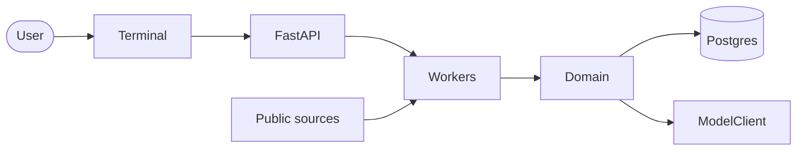
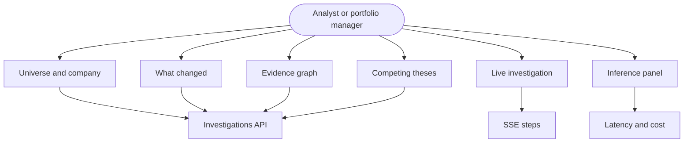
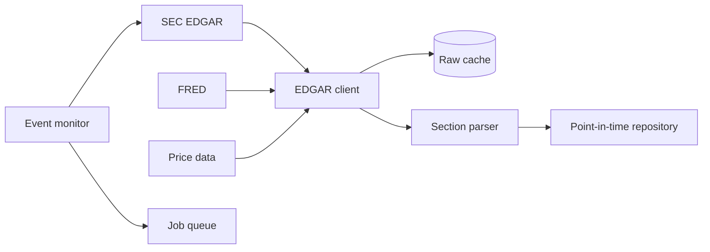
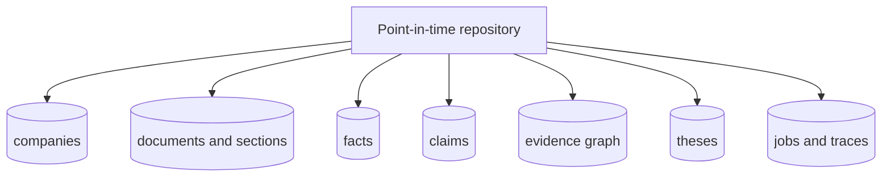
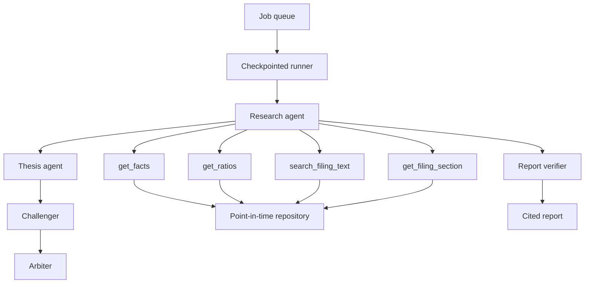
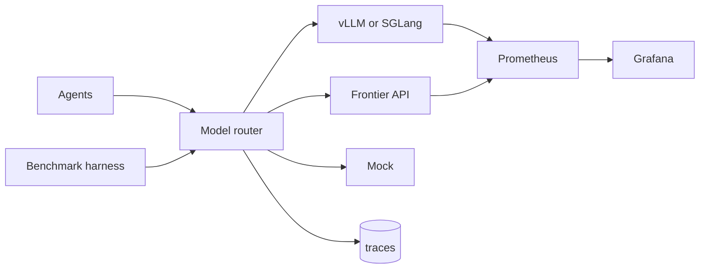
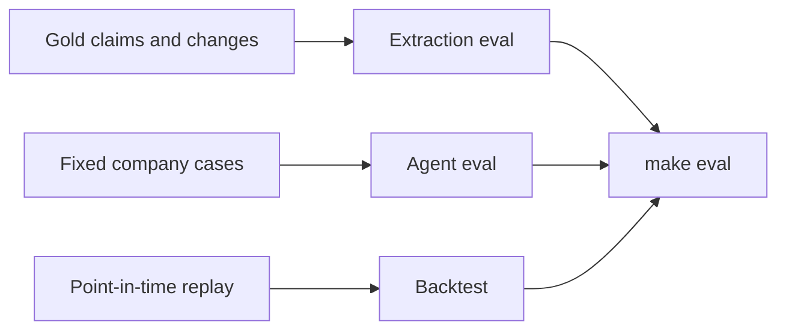
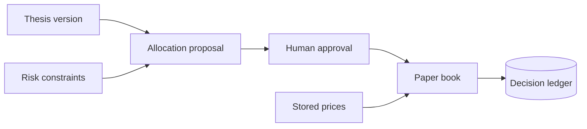

# TITAN system architecture

Research tool only. Not investment advice. Paper trading only.

Reads of filings and facts go through the point-in-time repository with an `as_of` timestamp. A row is visible only when `known_at` is at or before `as_of`. Numbers in a report come from stored XBRL facts or deterministic calculations, and every claim cites a document span or fact id.

## System

## Terminal

## Ingestion

The client sends a descriptive User-Agent, stays at or under 5 requests per second, and retries with backoff. Re-running ingestion for the same filing is a no-op.

## Point-in-time store

Every read takes `as_of` and drops rows whose `known_at` is later than that time. A fact is included when its source document is visible at that same cutoff. Application reads of documents and facts go through `backend/src/titan/pit/repository.py`. An AST test rejects a SQLAlchemy read of those tables from any other application module. A restated value is stored as its own row, so an earlier `as_of` still returns the value that was public then. The version list still contains the original after the amendment is public.

The Phase 1 tables, keys, and indexes are specified in [data-model.md](data-model.md). Sections, the evidence graph, theses, and the paper book are later phases.

## Investigation

Ratios are computed in code. The model chooses tools and writes prose. The verifier rejects any number that does not trace to a fact or a claim.

## Inference

Every model call goes through `ModelClient` and records model, tokens, latency, cost, and cache hit. The router starts on the smaller model and escalates when confidence is low.

## Measurement

## Paper portfolio

Optional. Paper trading only. No brokerage.

