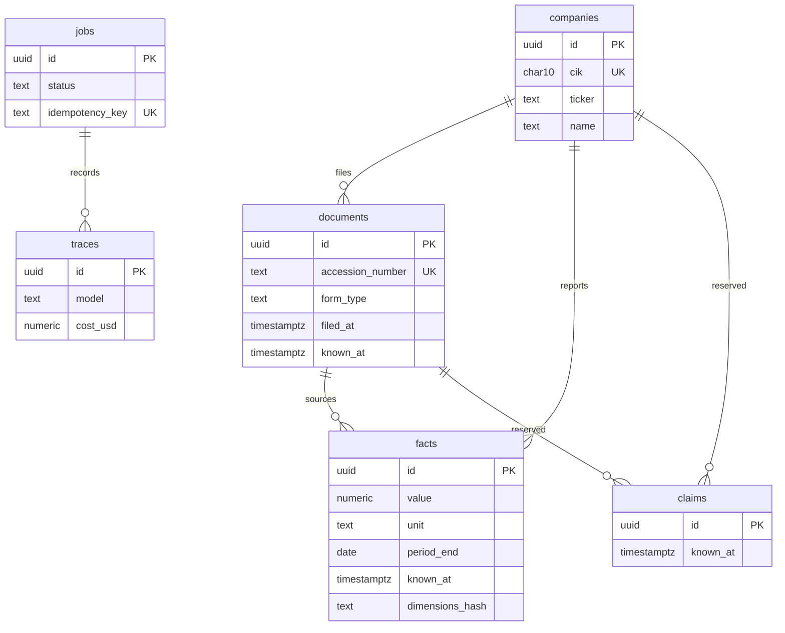

# Phase 1 data model

This is the Phase 1 schema, not the schema for the whole project. It is the point-in-time core later phases extend. The ORM models, Pydantic schemas, session factory, Alembic migration, and `backend/src/titan/pit/repository.py` implement it.

A row is visible only when `known_at <= as_of`. Surrogate keys are UUIDs. Public identity lives in natural keys. Fact values are append-only: a restatement inserts a new row and leaves the earlier one in place.



## Stable identity

| Entity | Stable public key | Surrogate |
|---|---|---|
| Company | CIK, 10 digits, zero-padded (`0000320193`) | `id UUID` |
| Document | Accession number, `##########-##-######` | `id UUID` |
| Fact | None. Identity is the logical key below, plus the source document | `id UUID` |
| Claim, job, trace | None in this phase | `id UUID` |

Ticker and legal name are labels. A ticker can change or be reused, so `ticker` is indexed and not unique. CIK is the company key.

An accession number is the SEC’s id for one submission, including an amendment (`10-K/A`). It is stored in dashed form and is unique. The original 10-K and a later amendment are two documents.

A fact has no SEC-wide id. Two rows are the same reported fact when all of these match:

`company_id`, `taxonomy`, `concept`, `unit`, `period_type`, `period_start`, `period_end`, `dimensions_hash`, `document_id`

`dimensions_hash` is the SHA-256 of canonical JSON (`{}` for an unsegmented total). The JSON object is also stored, with keys sorted, so segment facts do not collapse onto the company total. That column is part of identity, so it belongs in this phase.

## Time, money, units, and periods

Every timestamp column is `timestamptz`. The application writes timezone-aware UTC. Pydantic uses `AwareDatetime` and rejects naive datetimes.

`known_at` is when the row became public. For an EDGAR filing that is the SEC acceptance datetime, converted to UTC. A repository read keeps a row when `known_at <= as_of`. A fact is included only when that is also true of its source document.

`filed_at` is the filing timestamp. When SEC supplies only a filing date, it is stored as that date at `00:00:00+00`. It is metadata. It is not the visibility cutoff.

`period_start` and `period_end` are calendar `date`s, not timestamps. A duration fact (revenue) has both, and `period_start <= period_end`. An instant fact (assets) has `period_start` null and `period_end` set to the balance-sheet date. `fiscal_year` and `fiscal_period` (`FY`, `Q1`…) record how the filer tagged the fact. They are not part of identity, because the same calendar span can appear as both Q4 and FY.

`value` is PostgreSQL `NUMERIC(38, 10)`, mapped to Python `Decimal`. Floats are not used. The scale covers EPS and rates; the precision covers large share counts. `decimals` is a nullable integer for the XBRL precision hint when the source has one.

`unit` stores the XBRL unit string as published: `USD`, `shares`, `USD/shares`, `pure`. No currency conversion in this phase.

## Immutable versions and restatements

A fact row’s value, unit, period, dimensions, document, and `known_at` are never updated. A restatement is a new row: same logical key, new `document_id`, new `value`, new `known_at` (the later filing’s acceptance time). Both rows stay.

The as-of view keeps the row with the greatest `known_at` that is still `<= as_of` for each logical key. A query dated between the two filings returns the original. A query dated after the amendment returns the restated value.

Ingest is insert-only: `INSERT … ON CONFLICT DO NOTHING` on the fact unique key. Re-running a load does not change row counts. The same document cannot overwrite its own number.

`known_at` is copied onto the fact from its document at insert and then left alone. Phase 2 should resolve acceptance time before the first insert. The repository still joins the source document and applies the same cutoff there, so a fact cannot appear while its filing is still in the future.

## Repository query semantics

Application code reads `documents` and `facts` through `PointInTimeRepository` in `backend/src/titan/pit/repository.py`. Each method takes a timezone-aware `as_of`. The repository converts that instant to UTC. A naive datetime is rejected. The repository keeps no cutoff of its own: every call supplies the one it means.

A row with `known_at` equal to `as_of` is visible. A later `known_at` is excluded. `filed_at` and `period_of_report` do not decide visibility.

| Method | What it returns |
|---|---|
| `visible_documents` | Every filing for one company that was already public. Order: `known_at`, accession number, document id, ascending. |
| `visible_fact_versions` | Every stored fact version that was already public, including the original and a later restatement. The source document must be public too. Order: logical key, then `known_at`, accession number, and fact id, ascending. |
| `latest_visible_fact` | One version of an explicit logical fact, or nothing when that fact was not yet public. |

The logical fact is `taxonomy`, `concept`, `unit`, reporting period (`period_end`, and `period_start` when the fact is a duration), and `dimensions_hash`. Concept, unit, and period are the reported number. Taxonomy and the dimension hash stay in the identifier so a segment cannot be returned as the company total.

`latest_visible_fact` keeps the visible row with the greatest `known_at`. A shared `known_at` is broken by accession number descending, then fact id descending. That is the single-key form of the as-of index. `visible_fact_versions` uses the ascending form of the same order, so the last row of a logical key is the row `latest_visible_fact` returns. Taxonomy, concept, unit, dimensions hash, and accession number sort with the C collation. A null `period_start` sorts after a date.

Results are frozen read models. They are a snapshot of the cutoff, and they are the values callers may cite. The repository has no write methods. A restatement remains a new insert performed outside this module. Both versions stay readable after the amendment is public; the latest view then returns the restated value, and an earlier `as_of` still returns the original.

```sql
SELECT DISTINCT ON (
  facts.company_id,
  facts.taxonomy COLLATE "C",
  facts.concept COLLATE "C",
  facts.unit COLLATE "C",
  facts.period_end,
  facts.period_start,
  facts.dimensions_hash COLLATE "C"
)
  facts.*,
  documents.accession_number
FROM facts
JOIN documents
  ON documents.id = facts.document_id
 AND documents.company_id = facts.company_id
WHERE facts.company_id = :company_id
  AND facts.known_at <= :as_of
  AND documents.known_at <= :as_of
  AND facts.taxonomy = :taxonomy
  AND facts.concept = :concept
  AND facts.unit = :unit
  AND facts.period_end = :period_end
  AND facts.period_start IS NOT DISTINCT FROM :period_start
  AND facts.dimensions_hash = :dimensions_hash
ORDER BY
  facts.company_id,
  facts.taxonomy COLLATE "C",
  facts.concept COLLATE "C",
  facts.unit COLLATE "C",
  facts.period_end,
  facts.period_start,
  facts.dimensions_hash COLLATE "C",
  facts.known_at DESC,
  documents.accession_number COLLATE "C" DESC,
  facts.id DESC;
```

An instant fact uses `period_start IS NULL` in place of the `IS NOT DISTINCT FROM` comparison. Services and agents call this module. They do not select from `facts` or `documents`. A test scans `backend/src/titan` and fails when another module does.

## Constraints and indexes

`documents (id, company_id)` is unique so facts and claims can use a composite foreign key `(document_id, company_id)`. A fact cannot point at another company’s filing.

Facts:

- Unique `(document_id, taxonomy, concept, unit, period_start, period_end, dimensions_hash)` for idempotent ingest.
- Check: `period_type = 'duration'` implies both dates and `period_start <= period_end`; `period_type = 'instant'` implies `period_start` is null.
- As-of index, matching the `DISTINCT ON` order:

```sql
(company_id, taxonomy, concept, unit, period_end, period_start, dimensions_hash, known_at DESC)
```

Documents: unique `accession_number`; index `(company_id, known_at)`; index `(company_id, form_type, period_of_report)`.

Claims: index `(company_id, known_at)`.

Jobs: unique `idempotency_key` where it is not null; partial index `(status, run_after)` where `status = 'queued'`, for later `SKIP LOCKED`. Jobs are operational and have no `known_at`.

Traces: index `(job_id)`, index `(created_at)`. `cost_usd` is `NUMERIC(18, 8)`.

Form type, job status, and period type are text plus check constraints, so a new form type does not need an enum migration.

The fact index serves `latest_visible_fact`. Its column order is the `DISTINCT ON` / `ORDER BY` prefix above, with `known_at DESC` last. The repository adds the source-document predicate and the accession tie-break on top of that index order.

## Tables kept thin on purpose

Claims, in this phase, are only `id`, `company_id`, `document_id` nullable, `known_at`, and `created_at`. Predicate, span, polarity, extractor version, and confidence wait for Phase 5.

Jobs store `kind`, `status`, `payload jsonb`, `idempotency_key`, `run_after`, lock columns, `attempts`, and `last_error`. No checkpoint table until Phase 7.

Traces store `model`, `tokens_in`, `tokens_out`, `latency_ms`, `cost_usd`, `cache_hit`, and optional `job_id`. Prompt and completion text wait for Phase 3.

No evidence-graph, thesis, section, price, portfolio, or embedding tables. The pgvector image is already in Compose; the extension can be enabled in the first migration without an embedding column.

Later phases add their own tables:

| Phase | What gets added |
|---|---|
| 2 | Filing sections, with stable ids and character offsets |
| 3 | Investigations and reports; a pgvector column for filing search |
| 5 | The real claim columns, and evidence-graph nodes and edges |
| 6 | Material changes, with before/after evidence |
| 7 | Versioned theses, objections, and job checkpoints |
| 12–13 | Optional paper portfolio, prices, proposals, approvals, and a decision ledger |
| 16 | Users, roles, watchlists, audit log, and feedback |

## File paths

Settings and sessions:

- `backend/src/titan/common/settings.py` — `DATABASE_URL`, normalized to the psycopg driver
- `backend/src/titan/common/session.py` — synchronous engine and session factory
- `backend/src/titan/common/dimensions.py` — canonical dimension JSON and its SHA-256

ORM, SQLAlchemy 2.0 `Mapped` / `mapped_column`:

- `backend/src/titan/models/base.py` — `DeclarativeBase`, UTC mixin, naming convention
- `backend/src/titan/models/company.py`
- `backend/src/titan/models/document.py`
- `backend/src/titan/models/fact.py`
- `backend/src/titan/models/claim.py`
- `backend/src/titan/models/job.py`
- `backend/src/titan/models/trace.py`
- `backend/src/titan/models/__init__.py` — export `Base.metadata`

Pydantic v2, `extra="forbid"`, read models frozen:

- `backend/src/titan/schemas/types.py` — `Cik`, `AccessionNumber`, `AwareDatetime`
- `backend/src/titan/schemas/company.py`
- `backend/src/titan/schemas/document.py`
- `backend/src/titan/schemas/fact.py`
- `backend/src/titan/schemas/claim.py`
- `backend/src/titan/schemas/job.py`
- `backend/src/titan/schemas/trace.py`

Repository reads live in `backend/src/titan/pit/repository.py`. Alembic lives under `backend/alembic/`.

## Trade-offs

| Choice | Why |
|---|---|
| UUID primary keys plus CIK and accession unique keys | Joins stay stable if a CIK arrives unpadded. The public id remains searchable and unique. |
| `NUMERIC(38, 10)` rather than unbounded `NUMERIC` | Caps garbage inputs while covering SEC magnitudes and EPS. |
| `known_at` denormalized onto facts | The fact cutoff is a column on `facts`. The repository also requires the source document's `known_at <= as_of`, so a mismatched pair stays hidden. |
| Insert-only facts, update rejected | Restatements and idempotent ingest are expressed by the unique key. A `BEFORE UPDATE` trigger rejects changes to a stored version. `DELETE` and `TRUNCATE` still work, so tests can clean up. The ORM raises before flush as well. |
| `dimensions` in the fact key now | Without it, the first segmented XBRL ingest would merge segments into the company total. |
| Claims and traces are stubs | Phase 1 only needs the tables and `known_at` on claims. Later phases add columns by migration. |
| Separate Pydantic schemas from ORM classes | Row objects stay out of the validation boundary the later agents will use. |
| Text plus check constraints instead of Postgres enums | New 8-K variants and job states do not require a type migration. |
