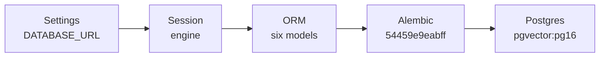
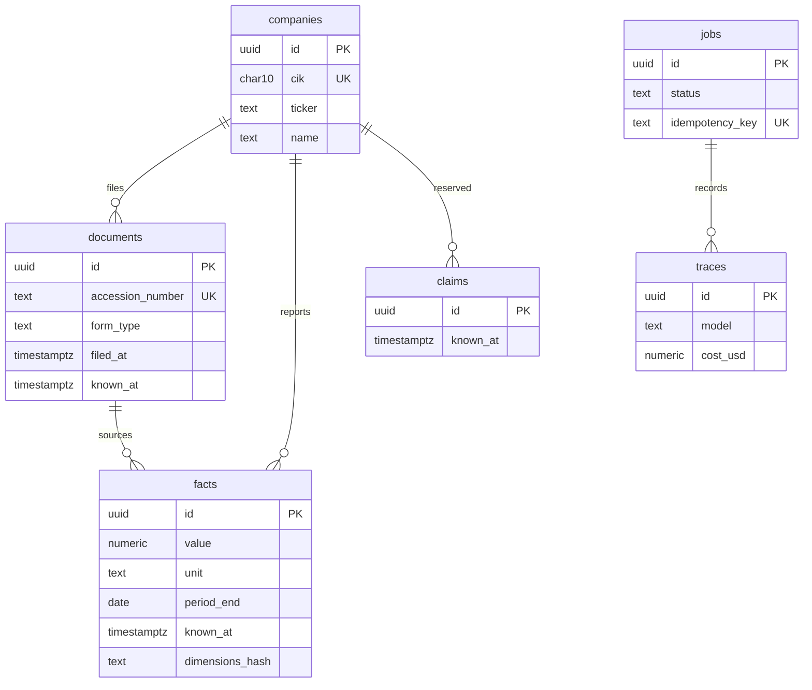
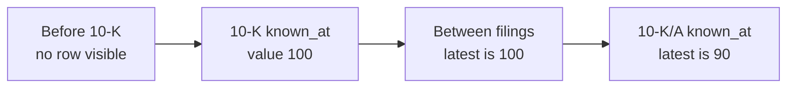
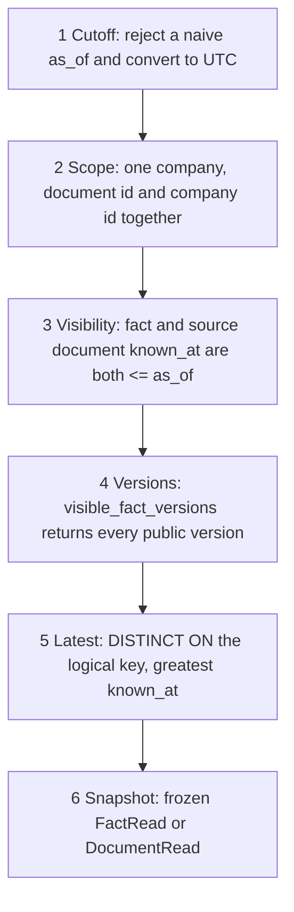

# TITAN Phase 1 technical report

**Point-in-time data model**

14 October 2026. Research foundations. Not investment advice.

A database where every fact knows when it became public, and a query cannot see the future. This report covers what is built: the schema, the migration, the repository, the leakage tests, and the read-path guard. Ingestion, agents, and the terminal are later phases.

## 1. Verdict

Both Phase 1 exit criteria pass. Phase 2 has not been started.

| Exit criterion | Evidence | Result |
|---|---|---|
| Leakage tests pass, including restated values. | Future facts stay hidden. Between a 10-K and a 10-K/A the latest value is the original. After the amendment both rows remain and the latest value is the restatement. | Pass |
| No application code outside the repository reads facts or documents. | An AST walk allows those SQLAlchemy reads only in `pit/repository.py`. A planted `select(Fact)` failed the test, then was removed. | Pass |

## 2. The problem this slice solves

TITAN has to answer what was publicly known at time T. A filing accepted on Tuesday must be invisible to a query dated Monday. A later 10-K/A that restates a number must leave the original in place. A query dated between the two filings returns the original. A query dated after the amendment returns the restated value.

Three project rules shaped every table.

1. **Point-in-time correctness.** A row is visible when `known_at` is at or before `as_of`. `known_at` is when the fact became public. For EDGAR that is the acceptance time, not the fiscal period end.
2. **Numbers come from code.** Financial values are `Decimal`, stored as PostgreSQL `numeric`. Floats are rejected at the schema boundary.
3. **Later claims will cite a source.** Each fact points at the filing that reported it. The claims table is only a stub until Phase 5.

## 3. Components that exist

Phase 1 is the store and the only application read path for documents and financial facts. It does not ingest filings and it does not call a model.

| Component | Path | Role |
|---|---|---|
| Settings | `backend/src/titan/common/settings.py` | Read `DATABASE_URL`. Rewrite `postgresql://` onto the psycopg v3 driver. |
| Sessions | `backend/src/titan/common/session.py` | Synchronous engine and `sessionmaker`. Callers commit or roll back. Import does not connect. |
| Dimensions | `backend/src/titan/common/dimensions.py` | Canonical JSON and its SHA-256. The hash is part of fact identity. |
| ORM | `backend/src/titan/models/` | Six SQLAlchemy 2.0 models. Importing `titan.models` registers every table. |
| Schemas | `backend/src/titan/schemas/` | Pydantic v2. Unknown fields are rejected. Read models are frozen. |
| Migration | `backend/alembic/` | Revision `54459e9eabff`. `env.py` uses `DatabaseSettings`, not the ini URL. |
| Repository | `backend/src/titan/pit/repository.py` | `visible_documents`, `visible_fact_versions`, `latest_visible_fact`. |
| Database | `docker/docker-compose.yml` | `pgvector/pgvector:pg16`. User `titan`, database `titan`, port 5432. |
| Gate | `Makefile` | `make check` runs ruff, mypy (strict in `pyproject.toml`), and pytest. |

## 4. How the pieces connect

Configuration, models, and the migration form one path into Postgres. Queries form a second path that always carries a cutoff. The ORM class and the Pydantic model do not inherit from each other.




Pydantic schemas do not inherit from the ORM. A `FactCreate` validates a payload. A `Fact` is a row. Services are not built yet. When they are, they call `PointInTimeRepository`.

## 5. The six tables

Companies, documents, and facts are the financial core. Claims are reserved. Jobs and traces are operational and have no `known_at`, because they are not public facts. Surrogate keys are UUIDs. Public identity is CIK and accession number.



### Stable identity

| Entity | Public key | Notes |
|---|---|---|
| Company | CIK, 10 digits, zero-padded | Ticker is indexed and not unique. A ticker can change or be reused. |
| Document | Accession `##########-##-######` | A 10-K and a later 10-K/A are two documents. |
| Fact | Logical key plus source document | No SEC-wide id. The UUID is only the surrogate. |
| Claim, job, trace | UUID only | Claims gain predicate, span, and confidence in Phase 5. |

Two fact rows are the same reported number when company, taxonomy, concept, unit, period type, period start, period end, dimensions hash, and document match. `dimensions_hash` is the SHA-256 of canonical JSON with sorted keys. An empty object is the company total. A segment is a different object, so it cannot collapse onto the total. The database checks that the hash is 64 hex characters. It does not recompute the hash, because PostgreSQL JSON text is not the canonical byte string. `FactCreate` and a `before_insert` listener both reject a mismatched hash.

## 6. Time, money, and periods

- Every timestamp is `timestamptz`. The application writes timezone-aware UTC. Pydantic rejects a naive datetime.
- `known_at` is the visibility cutoff. `filed_at` is filing metadata. A date-only filing time is stored as that date at `00:00:00+00`.
- `period_start` and `period_end` are calendar dates. A duration fact has both, with `period_start` on or before `period_end`. An instant fact has `period_start` null.
- `fiscal_year` and `fiscal_period` record the filer's tag. They are not part of identity, because the same calendar span can be both Q4 and FY.
- `value` is `numeric(38, 10)`. The precision covers large share counts. The scale covers EPS and rates. `unit` is the XBRL unit as published: `USD`, `shares`, `USD/shares`, `pure`. There is no currency conversion in this phase.

## 7. Restatements

A fact row is never updated. A restatement is a new row: same logical key, new document, new value, new `known_at`. Both rows stay. The as-of view keeps the visible row with the greatest `known_at`.



Equal `known_at` is visible. One microsecond earlier is not. `filed_at` does not decide visibility. After the amendment, `visible_fact_versions` still returns 100 and 90. `latest_visible_fact` returns 90. An earlier `as_of` still returns 100.

The ORM raises `FactImmutableError` before flush. The database trigger `facts_append_only` calls `facts_reject_update()` on `BEFORE UPDATE`. `DELETE` and `TRUNCATE` still work, so tests can clean up. A second insert of the same source identity hits `uq_facts_source_identity`. That constraint is `UNIQUE NULLS NOT DISTINCT`, so two instant facts with a null `period_start` collide. There is no ingest writer in this phase, and no `ON CONFLICT DO NOTHING`. Phase 2 can use that conflict target so a reload changes nothing.

`known_at` is copied onto the fact from its document at insert and then left alone. The repository still joins the source document and applies the same cutoff there. A fact whose own `known_at` is already in the past stays hidden while its filing is still in the future.

## 8. Repository query semantics

`PointInTimeRepository` does not remember `as_of`. Every call passes the cutoff it means. Results are frozen snapshots taken while the session is open.



| Method | Returns |
|---|---|
| `visible_documents` | Every filing for one company that was already public. Order: `known_at`, accession number, document id. |
| `visible_fact_versions` | Every stored fact version that was already public, including the original and a later restatement. Does not collapse versions. |
| `latest_visible_fact` | One version of an explicit logical fact, or nothing. Greatest `known_at` wins. A tie breaks on accession number, then fact id. |

The logical fact passed to `latest_visible_fact` is taxonomy, concept, unit, reporting period, and dimensions hash. Concept, unit, and period are the reported number. Taxonomy and the dimension hash stay in the identifier so a segment cannot be returned as the company total. Text sort keys use `COLLATE "C"`, so `USD` stays before `shares` if the database locale would otherwise reverse them. A null `period_start` sorts after a date.

```sql
SELECT DISTINCT ON (
  company, taxonomy, concept, unit,
  period_end, period_start, dimensions_hash
)
FROM facts
JOIN documents
  ON documents.id = facts.document_id
 AND documents.company_id = facts.company_id
WHERE facts.known_at <= :as_of
  AND documents.known_at <= :as_of
ORDER BY logical key,
         facts.known_at DESC,
         accession_number DESC,
         facts.id DESC;
```

`ix_facts_as_of` matches that `DISTINCT ON` prefix and ends in `known_at DESC`. The repository adds the source-document predicate and the accession tie-break on top of the index order.

## 9. The read-path guard

`backend/tests/test_no_direct_financial_reads.py` parses `backend/src/titan` with the Python AST. It fails when any module other than `pit/repository.py` builds a SQLAlchemy read of `Fact` or `Document`. A new service file is scanned with no extra registration. Inserts stay legal, because ingestion will write rows outside the repository. Alembic and tests are outside the walk: they create schema and seed rows.

The checker flags `select` (including `Table.select()`), `query`, `get`, `get_one`, `join`, `outerjoin`, `join_from`, `where`, `filter`, `having`, `order_by`, `group_by`, the usual loader options, and `text`, `execute`, or `exec_driver_sql` whose SQL names `facts` or `documents` in `FROM` or `JOIN`. Import aliases, `aliased()`, and names assigned from those classes count.

This review added `services/filing_reader.py` with `return select(Fact)`. The guard failed with `services/filing_reader.py:9:11: select`. The file was removed. The same test then passed.

Static blind spots, locked by a test:

- `select(model)` when `model` is a parameter.
- `getattr(models, "Fact")` and any other computed attribute.
- `exec` or `eval` of source that would have been flagged.
- SQL whose table name is interpolated from a non-constant.
- A parameter named `Fact` that shadows the imported class.
- A comparison stored on its own and later passed to `where()`.

## 10. Constraints and indexes

`documents (id, company_id)` is unique so facts and claims can use a composite foreign key. A fact cannot point at another company's filing. Form type, job status, and period type are text plus check constraints, so a new form type does not need an enum migration.

| Object | What it enforces |
|---|---|
| `uq_facts_source_identity` | `UNIQUE NULLS NOT DISTINCT` on document, taxonomy, concept, unit, period start, period end, dimensions hash. |
| `ck_facts_period` | Duration facts have both dates. Instant facts have a null start. |
| `ix_facts_as_of` | `(company, taxonomy, concept, unit, period_end, period_start, dimensions_hash, known_at DESC)`. |
| `ix_documents_company_known_at` | Filings for one company that were public by T. |
| `ix_jobs_queued_run_after` | Partial index `WHERE status = 'queued'`, for a later `SKIP LOCKED` worker. |
| `uq_jobs_idempotency_key` | Unique only where the key is not null. |
| `facts_append_only` | `BEFORE UPDATE` trigger. `alembic check` does not see it. `psql` confirmed it. |

The `vector` extension is created in this migration. No embedding column is added. Compose already runs the pgvector image, so a later phase can add a vector column without a separate extension migration.

## 11. What was measured

Reviewed on 14 October 2026 against Compose container `titan2-db-1`. Interpreter and tools: Python 3.15.0, ruff 0.17.0, mypy 2.4.0, pytest 9.1.1, Alembic 1.20.0, SQLAlchemy 2.1.4, Pydantic 2.14.1. The project requires Python 3.11 or newer.

`make check`, after the probe file was removed:

```text
cd backend && uv run ruff check .
All checks passed!
cd backend && uv run mypy src
Success: no issues found in 31 source files
cd backend && uv run pytest -q
54 passed in 0.54s
```

No tests were skipped, so the leakage cases ran against the migrated database. A verbose run was also 54 passed in 0.54s. The read-path test alone, after the probe was removed, was 1 passed in 0.06s.

`uv run alembic upgrade head` applied nothing, because the database was already at head. `uv run alembic check` reported no new upgrade operations. `uv run alembic current` reported `54459e9eabff (head)`. History is a single revision: initial financial evidence schema.

`psql \dt` listed `alembic_version`, `claims`, `companies`, `documents`, `facts`, `jobs`, and `traces`. `pg_extension` contains `vector`. `facts.value` is `numeric(38,10)` NOT NULL. `facts.known_at` and `documents.known_at` are `timestamp with time zone` NOT NULL. `companies.cik` is `character(10)`. Both composite foreign keys reference `documents (id, company_id)` with `ON DELETE RESTRICT`.

Leakage cases that passed:

- `test_future_fact_is_invisible`
- `test_fact_becomes_visible_at_exact_known_at`
- `test_restatement_switches_only_after_the_amendment`
- `test_fact_waits_for_its_source_document`
- `test_restatement_preserves_the_original_and_as_of_selects_the_known_value`
- `test_fact_stays_hidden_until_its_source_document_is_visible`
- `test_future_fact_on_an_already_public_document_stays_hidden`
- `test_boundary_includes_the_cutoff_and_ignores_filed_at`
- `test_restatement_keeps_both_versions`
- `test_database_rejects_fact_updates`
- `test_same_instant_fact_cannot_be_inserted_twice`

## 12. What broke, and the fix

| What broke | Fix |
|---|---|
| The first migration was a placeholder: `companies (id integer, ticker)`, already stamped as head. | Downgraded to base, deleted, and replaced by `54459e9eabff`. Editing the applied file in place would have left the integer table behind. |
| Check names were doubled, such as `ck_companies_ck_companies_cik_digits`. | Models pass the suffix only. Postgres stores `ck_companies_cik_digits`. |
| `company.id` was null before flush, so a document inserted with a null `company_id`. | An init listener assigns a UUID at construction. `gen_random_uuid()` remains the server default. |
| Default collation sorted `shares` before `USD`. | Taxonomy, concept, unit, dimensions hash, and accession number use `COLLATE "C"`. |
| ruff 0.17 reported `FURB157` on `Decimal("100")` in the leakage tests. | Those integer assertions now use `Decimal(100)`, which is exact for these integers. `ruff check .` is clean. |
| A direct `select(Fact)` outside the repository. | The AST test failed at `services/filing_reader.py:9:11`. The module was removed. |

## 13. Known limits

- No EDGAR client, filing parser, agent, or `ModelClient`. The repository only reads.
- No evidence graph, thesis, price, portfolio, or embedding column. The `vector` extension is installed and unused.
- Claims store id, company, optional document, `known_at`, and `created_at`. Predicate, span, polarity, extractor version, and confidence wait for Phase 5.
- Traces store model, tokens, latency, cost, and cache hit. Prompt and completion text wait for Phase 3.
- Jobs have a queued partial index and no worker. Checkpoints wait for Phase 7.
- `alembic check` does not see the append-only trigger or `CREATE EXTENSION vector`. Those were checked with `psql`.
- Database tests skip when Postgres is down or `public.facts` is missing. This run did not skip.
- The read-path guard cannot see the indirect shapes listed in section 9.

## 14. Where to read the design

`docs/data-model.md` is the schema this code implements. `docs/notes/phase-01.md` records what was built, what was measured, and what broke. `docs/architecture.md` places this store in the larger system. Sections, the evidence graph, theses, and the paper book are drawn there as later phases.

Phase 1 is complete. The next instruction is `START PHASE 2`.
